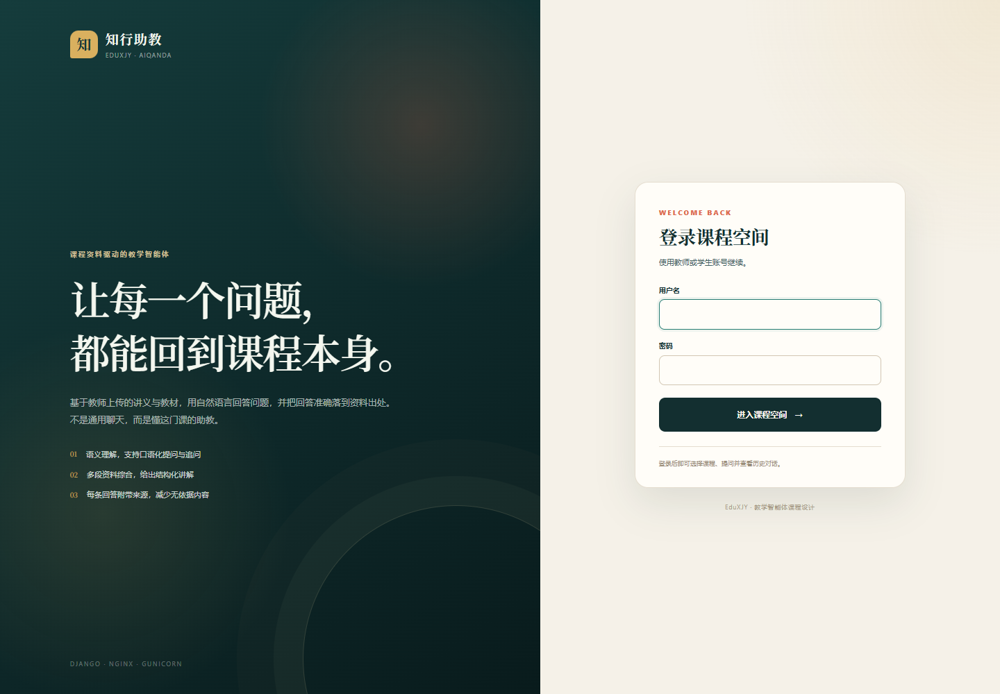
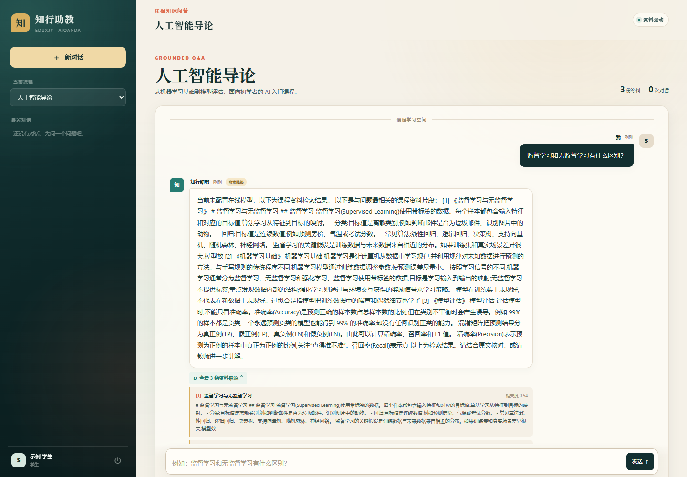
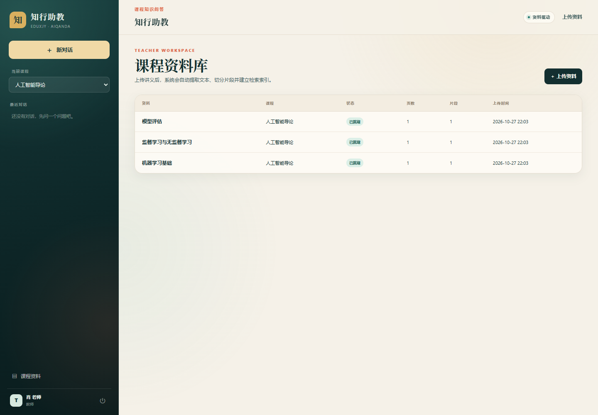
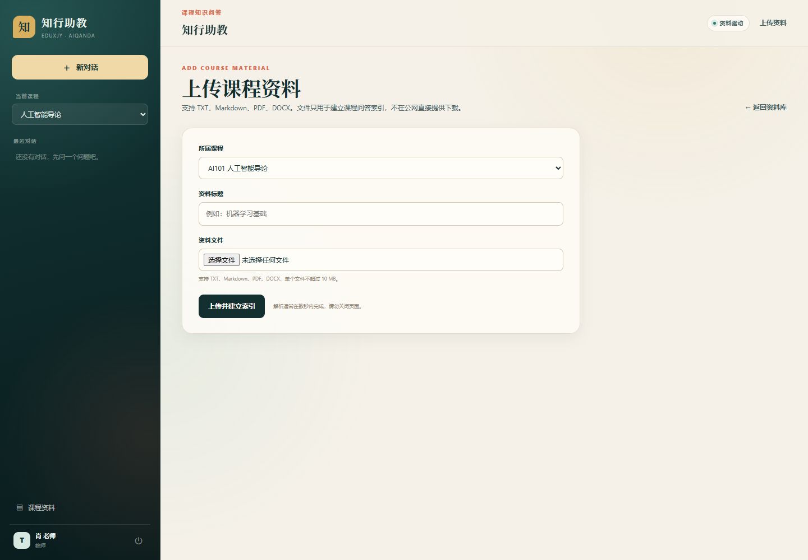
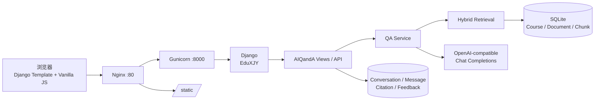

# EduXJY · 知行助教

> 基于 Django 的课程资料驱动教学智能体。学生用自然语言提问，系统先检索教师上传的讲义，再生成带来源引用的回答；没有资料依据时明确拒答，AI 不可用时自动降级为检索模式。

- 项目名：`EduXJY`
- Django App：`AIQandA`
- 姓名：肖俊阳
- 云主机 hostname：`xiaojunyang`
- 公网访问：<http://121.40.192.55/>
- 代码仓库：<https://github.com/tqchitoge6/EduXJY>

---

## 界面预览

| 登录 | 课程问答 |
| --- | --- |
|  |  |

| 课程资料库 | 上传资料 |
| --- | --- |
|  |  |

> 当前部署未配置在线模型 Key，问答截图显示的是**检索降级模式**：仍然基于课程资料并附来源，但不会生成模型润色后的讲解。配置 `AI_API_KEY` 后会自动切换为 `ai` 模式。

---

## 1. 功能点：课程资料驱动的 AI 问答

本项目只聚焦一个教学场景：**课程知识问答**。它不是通用聊天机器人，而是把回答限制在教师提供的课程资料内，并让学生能看到依据。

典型使用流程：

1. 教师进入“课程资料”，上传讲义（TXT / Markdown / PDF / DOCX）。
2. 系统提取文本、按语义段落切块，建立可检索索引；配置 Embedding 后同时保存向量。
3. 学生选择课程并提问。
4. 系统检索 Top-K 个相关片段，组装受约束的 Prompt，调用 OpenAI 兼容模型。
5. 回答落库，并保存资料名、页码、原文摘录和检索得分。
6. 学生可以点赞/点踩；教师可在 Admin 中查看反馈。

### 为什么加入 AI 后效果更好

| 维度 | 传统关键词 FAQ / 资料检索 | AIQandA |
| --- | --- | --- |
| 提问方式 | 必须命中关键词 | 理解口语、同义表达和追问 |
| 返回内容 | 整段资料或搜索列表 | 跨段落综合后的结构化讲解 |
| 个性化 | 所有学生看到同一段文字 | 可以要求“再简单一点”“举个例子” |
| 可追溯 | 只给搜索结果 | 每条回答附资料、页码和原文 |
| 资料不足 | 容易给出无关内容 | 明确说“资料中暂未找到” |
| 教师反馈 | 不知道学生卡在哪里 | 点赞/点踩和问题历史形成改进依据 |

AI 带来的不是“多一个聊天框”，而是把**检索、综合、讲解、引用、反馈**连接成学习闭环。

### 可信与安全设计

- **RAG 接地**：回答只使用检索到的课程片段。
- **来源引用**：`Citation` 记录回答对应的资料片段，前端可展开原文。
- **无依据拒答**：没有相关片段时不调用模型编造。
- **提示词注入防护**：课程资料中的指令被当作普通文本，不执行。
- **服务端 Key**：API Key 只保存在 `.env`，不下发浏览器、不进入 Git。
- **降级可用**：未配置 Key、超时、非 2xx、空响应时返回检索式回答，并标记“检索降级”。
- **额度保护**：默认每名学生每天 100 次提问，教师账号不受限。

---

## 2. 系统架构



- Nginx 负责静态文件和反向代理，Gunicorn 运行 WSGI 应用。
- SQLite 适合课程演示；生产可平滑迁移到 PostgreSQL + pgvector。
- 前端不依赖 CDN，云主机离线也能加载样式和脚本。

---

## 3. 技术栈

- Python `3.10+`（开发环境 3.13）
- Django `5.2.18` LTS
- SQLite
- `requests`、`python-dotenv`、`pypdf`、`python-docx`
- Gunicorn + Nginx + systemd
- pytest / pytest-django / pytest-cov
- Black / Pylint / pylint-django

---

## 4. 快速开始

### 4.1 克隆并配置

```bash
git clone https://github.com/<github-username>/EduXJY.git
cd EduXJY
cp .env.example .env
```

编辑 `.env`：

```dotenv
DJANGO_DEBUG=True
DJANGO_SECRET_KEY=请生成一个长随机字符串
DJANGO_ALLOWED_HOSTS=localhost,127.0.0.1,[::1],testserver
AI_BASE_URL=https://api.openai.com/v1
AI_API_KEY=
AI_MODEL=gpt-4o-mini
AI_EMBEDDING_MODEL=
DEMO_PASSWORD=请设置演示账号密码
```

`AI_API_KEY` 留空也能运行，应用会使用检索式降级回答。

### 4.2 安装、初始化、启动

Linux / macOS：

```bash
make install
make migrate
make seed
make run
```

Windows（PowerShell，需要 GNU Make；没有 `make` 时用 `mingw32-make`）：

```powershell
mingw32-make install
mingw32-make migrate
mingw32-make seed
mingw32-make run
```

打开 <http://127.0.0.1:8000/>。

演示账号由 `DEMO_PASSWORD` 决定：

- 教师：`teacher`
- 学生：`student`

### 4.3 一次跑通质量检查

```bash
make install lint test format
```

也可以使用默认目标：

```bash
make          # 等价于 make install lint test
```

---

## 5. Makefile

| 目标 | 作用 |
| --- | --- |
| `make install` | 创建 `.venv`，安装 `requirements.txt` |
| `make lint` | `black --check` + `pylint`（含 Django 插件） |
| `make test` | `pytest` + 覆盖率报告 |
| `make format` | 用 Black 格式化 |
| `make all` | `install` → `lint` → `test` |
| `make migrate` | 执行数据库迁移 |
| `make seed` | 创建演示课程、资料、教师和学生 |
| `make run` | 启动本地开发服务器 |
| `make check` | Django check + 迁移一致性检查 |
| `make collectstatic` | 收集静态文件 |
| `make deploy-check` | `manage.py check --deploy` |

Makefile 会根据 `OS` 自动选择 Windows 的 `.venv/Scripts/python.exe` 或 POSIX 的 `.venv/bin/python`，因此同一份文件可以在 Windows 和 Ubuntu 使用。

---

## 6. 数据库设计

内置 `auth_user` 作为用户表。业务表如下：

| 表 | 关键字段 | 作用 |
| --- | --- | --- |
| `AIQandA_course` | code、title、description | 课程 |
| `AIQandA_knowledgedocument` | course、uploaded_by、title、file、status、page_count、extracted_text | 上传的课程资料及处理状态 |
| `AIQandA_documentchunk` | document、chunk_index、page_number、content、embedding | 可检索资料片段，可选向量 |
| `AIQandA_conversation` | user、course、title、updated_at | 学生在某门课下的对话 |
| `AIQandA_message` | conversation、role、content、mode、model_name、latency_ms | 学生问题和助教回答 |
| `AIQandA_citation` | message、chunk、rank、score、quote | 回答到资料片段的引用 |
| `AIQandA_answerfeedback` | message、user、rating、comment | 点赞/点踩反馈 |

关系：

```text
User 1─N Conversation N─1 Course
Course 1─N KnowledgeDocument 1─N DocumentChunk
Conversation 1─N Message 1─N Citation N─1 DocumentChunk
Message 1─1 AnswerFeedback N─1 User
```

关键约束与索引：

- `(course, title)` 唯一，避免同课程重复上传。
- `(document, chunk_index)` 唯一；`(document, chunk_index)` 索引。
- `(message, chunk)` 唯一；`(message, rank)` 唯一且索引。
- `Message.role`、`AnswerFeedback.rating` 使用 CheckConstraint。
- 会话按 `(user, -updated_at)` 建索引，支撑侧边栏最近对话。
- 删除课程级联删除资料与对话；删除资料级联删除片段与引用。

完整数据字典见报告第 5 章。

---

## 7. 目录结构

```text
EduXJY/
├── manage.py
├── EduXJY/                  # settings / urls / wsgi / asgi
├── AIQandA/
│   ├── models.py            # 7 个业务模型
│   ├── views.py             # 页面与 JSON API
│   ├── forms.py
│   ├── urls.py
│   ├── admin.py
│   ├── services/
│   │   ├── documents.py     # 解析、切块、索引入口
│   │   ├── retrieval.py     # 中文 n-gram + 可选向量混合检索
│   │   ├── embeddings.py    # 可选 Embedding 客户端
│   │   ├── llm.py           # Prompt 与降级
│   │   ├── qa.py            # 问答编排
│   │   └── provider.py      # OpenAI 兼容端点
│   ├── management/commands/seed_demo.py
│   ├── templates/AIQandA/
│   ├── static/AIQandA/
│   ├── migrations/
│   └── tests/               # 55 个 pytest 用例
├── deploy/                  # systemd / Nginx / 部署说明
├── docs/images/             # 可公开的产品截图
├── .vscode/                 # VS Code 运行与测试配置
├── .env.example
├── requirements.txt
├── pyproject.toml
├── .pylintrc
├── Makefile
└── README.md
```

---

## 8. API

### `POST /api/ask/`

登录 + CSRF。

```json
{
  "conversation_id": 12,
  "course_id": 1,
  "question": "监督学习和无监督学习有什么区别？"
}
```

```json
{
  "conversation_id": 12,
  "message_id": 34,
  "answer": "…… [1] …… [2]",
  "mode": "ai",
  "citations": [
    {
      "index": 1,
      "document": "监督学习与无监督学习",
      "page": null,
      "quote": "监督学习使用带标签的数据……",
      "score": 0.82
    }
  ]
}
```

错误码：400 参数错误、401/302 未登录、404 越权会话、429 每日额度耗尽、502 生成异常。

### `POST /api/messages/<id>/feedback/`

```json
{"rating": "up", "comment": ""}
```

只能评价自己会话中的 assistant 消息；重复提交更新原反馈。

### `GET /healthz/`

```json
{"status": "ok", "database": "ok"}
```

用于 Nginx/Gunicorn 部署验证。

---

## 9. 测试与代码质量

```text
55 passed
测试覆盖率：88%
pylint：10.00/10
Black：check 通过
```

测试覆盖：

- 模型唯一约束、级联关系、反馈 one-to-one
- 中文 n-gram 检索、向量余弦、追问查询
- 文档切块、TXT/DOCX 解析、失败状态
- 无 Key、模型成功、模型异常、空回答降级
- 未登录、越权会话、参数校验、CSRF
- 每日额度、教师豁免
- 上传白名单、大小、重复标题
- 反馈创建/更新/越权/非法值
- 健康检查、管理命令幂等

运行：

```bash
make test
make lint
make format
```

---

## 10. 部署

详细步骤见 [`deploy/README.md`](deploy/README.md)。

目标环境：

- 云主机公网 IP：`121.40.192.55`
- hostname：`xiaojunyang`
- Nginx 监听 80，反向代理到 `127.0.0.1:8000`
- Gunicorn 由 systemd 管理
- `/static/` 由 Nginx 提供；`/media/` 不公开
- 公网访问：<http://121.40.192.55/>

---

## 11. 安全与限制

- `.env`、数据库、上传文件、虚拟环境、报告均不提交 Git。
- API Key 仅在服务端使用，前端不接触。
- 上传文件按 UUID 重命名，限制扩展名和大小；媒体目录禁止公网直接访问。
- 演示环境使用 SQLite 和 HTTP；生产建议 PostgreSQL + pgvector、Celery 异步解析、HTTPS 和更细粒度限流。
- AI 回答可能存在错误；引用和“资料不足”提示是降低风险的手段，不保证 100% 正确。

---

## 12. 许可

本项目为课程设计作品，仅用于教学与学习。
